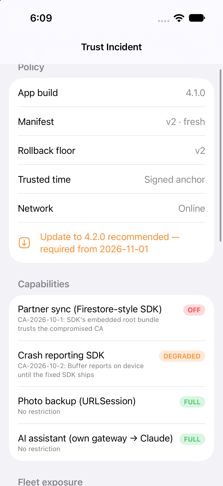
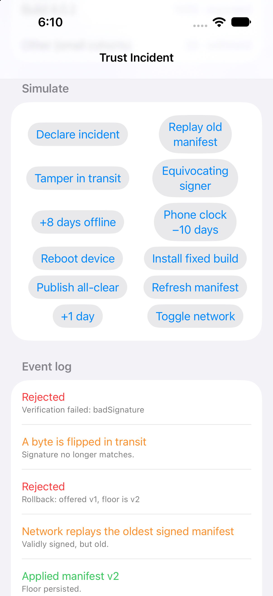
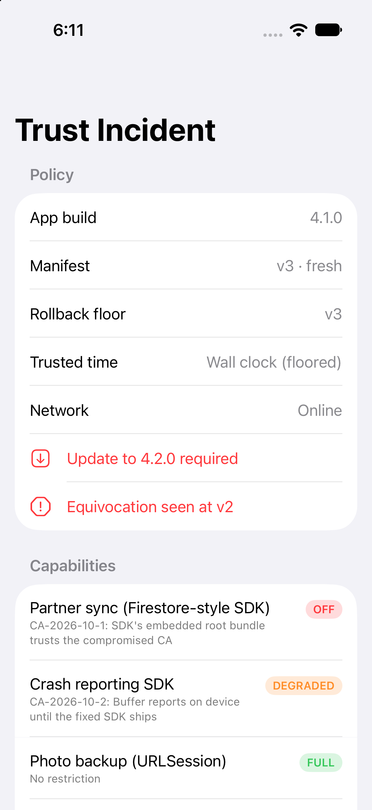
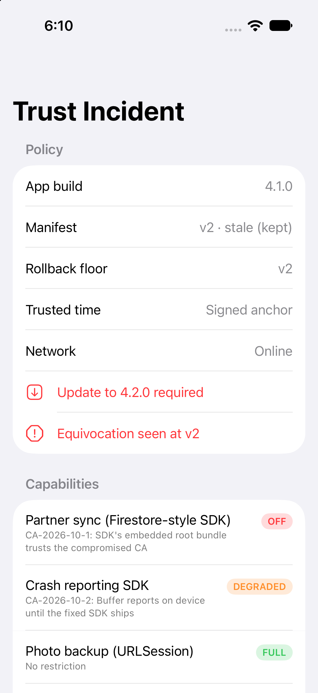
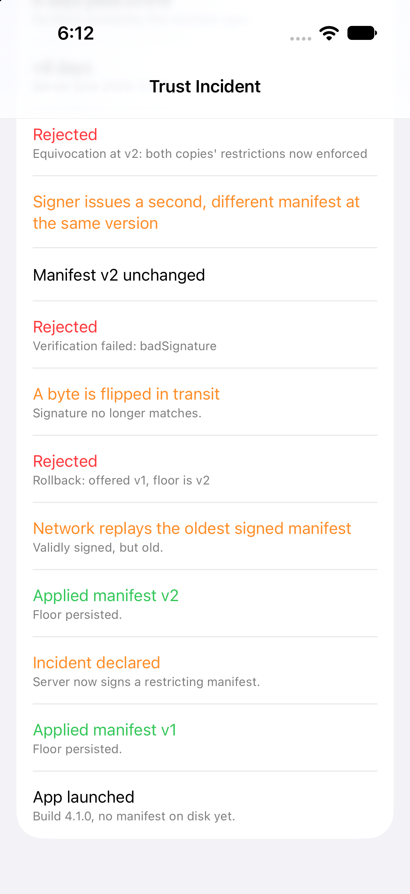
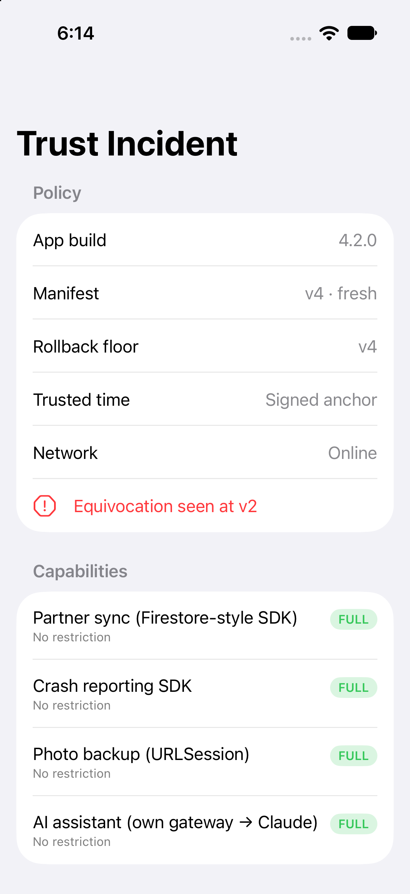

# Trust Incident Demo

**A CA gets compromised on Monday. Your OS update covers `URLSession`, but not the SDK that ships its own root list.** This app walks one trust incident from start to finish against the real [`TrustRemediation`](https://github.com/rajatslakhina/trust-incident-remediation-kit) library. You declare the incident, attack the channel the fix travels on, let the manifest go stale, reboot the phone with its clock wound back, and ship the fixed build. At each step you can watch which network paths the app still allows.

It is deliberately a separate repository. The app consumes the library the way a product team would: as a **remote Swift package pinned to `1.x`** (`XCRemoteSwiftPackageReference`, `upToNextMajorVersion` from `1.0.0`), not as a local path or a branch.

## Why this matters

When a trust incident hits, the people who have to act are leads, not individual feature owners. They need to know which network paths the OS block doesn't reach, how to switch those paths off in binaries already on phones, how to stop an attacker from replaying yesterday's "all clear", when to move from "please update" to "update required", and how much of the fleet is still exposed. This demo makes each of those decisions visible and lets you try to break it.

## What you can do in it

The first nine buttons on screen are the rows of this table, in this order. Run them top to bottom, starting with **Declare incident**: before the incident there is nothing older to replay, and no deadline for the clock to pass. The last three buttons (**Refresh manifest**, **+1 day**, **Toggle network**) are free play. If you take the network down, bring it back before **Install fixed build** and **Publish all-clear**, because both need a fetch.

| Button | What happens | What to look for |
|---|---|---|
| **Declare incident** | The in-process server signs a manifest that disables partner sync and degrades crash reporting on builds below 4.2.0, and schedules hard enforcement 3 days out | Capability badges flip to OFF / DEGRADED; the upgrade banner shows the deadline; fleet exposure jumps |
| **Replay old manifest** | The network replays the first, unrestricted, validly signed manifest | Rejected as rollback; badges don't change |
| **Tamper in transit** | One byte of the payload is flipped | Rejected: `badSignature` |
| **Equivocating signer** | A second, different (unrestricted) manifest is signed at the same version | It doesn't replace the first copy. Both copies' restrictions are enforced, so badges stay OFF, and an equivocation warning appears |
| **+8 days offline** | Time passes with no fetch | The manifest goes stale but keeps its restrictions; the deadline passes and enforcement becomes *required* |
| **Phone clock −10 days** | The user winds the wall clock back | Nothing changes, because trusted time is signed time plus uptime |
| **Reboot device** | Uptime resets, so there is no signed anchor this boot | Time basis shows "Wall clock (floored)"; still *required* |
| **Install fixed build** | The app becomes 4.2.0 and relaunches | The rules no longer match; the upgrade requirement clears |
| **Publish all-clear** | A newer manifest lifts every rule | Everything returns to FULL |

The compiled-in policy lives in [`Demo/DemoApp.swift`](Demo/DemoApp.swift) (`AppPolicy`). It declares four capabilities, each with the trust store it actually uses, and that file is the only thing a real app would need to write.

## Design decisions

- **The app owns only its policy.** `AppPolicy` declares which network capabilities exist and which trust store each actually uses. Everything else (verification, rollback floor, trusted time, gating, enforcement) is the library's job. The manifest can only restrict what this file declares, so this file is also the complete list of things an incident can switch off.
- **Crash reporting degrades instead of switching off, and survives hard enforcement** (`blockedWhenUpgradeRequired: false`). During an incident, crash data from the vulnerable fleet is what tells you whether the fix works. So reports are buffered on device rather than dropped, and they are sent once the fixed SDK ships. Partner sync, which moves user data over the exposed path, is switched off completely.
- **An in-process, deterministic lab instead of a real server.** The "server" signs real Ed25519 manifests, and the hostile network replays, tampers with and forks them, all inside the app. The clock, uptime and fleet are simulated. This makes every step repeatable and lets the library's `LabTests` drive the same script on Linux. *What it leaves untested:* real TLS, real push delivery, and real `URLSession` behaviour under a distrusted root. *Rejected:* a hosted demo backend. It would add infrastructure to keep alive, and it couldn't simulate the attacks honestly.
- **k = 50 on the exposure dashboard.** A 30-install legacy cohort and a 9-install internal build are folded into one "other" bucket with exposure withheld. That shows the k-anonymity rule doing something without hiding the headline number.
- **A version requirement plus a lockfile.** The project requires `upToNextMajorVersion` from `1.0.0`. The `Package.resolved` that Xcode wrote when it first resolved the package is committed under `Demo.xcodeproj/project.xcworkspace/xcshareddata/swiftpm/`, so every clone and every CI run builds against the same revisions:
  - TrustRemediation 1.0.0 (`3f044b0`)
  - swift-crypto 3.15.1
  - swift-asn1 1.7.3

  Moving to a later 1.x is a deliberate lockfile change, not whatever `main` happens to be that day.

## Screenshots

These are real captures from the Simulator run described under Verification: an iPhone 17 Pro simulator on iOS 27.0, built with Xcode 27.1, captured with `xcrun simctl io <device> screenshot`.

<table>
  <tr>
    <td align="center"> <b>Incident declared.</b> Signed manifest v2: partner sync OFF, crash reports DEGRADED, update required from a signed date.</td>
    <td align="center"> <b>Attacks rejected.</b> A replayed v1 fails the rollback floor; a flipped byte fails Ed25519.</td>
    <td align="center"> <b>Reboot with the clock wound back 10 days.</b> No signed anchor this boot, so the wall clock is floored. The update is still <i>required</i>.</td>
  </tr>
  <tr>
    <td align="center"> <b>8 days offline.</b> The manifest is stale but its restrictions stay; the deadline has passed.</td>
    <td align="center"> <b>Event log.</b> Rollback, bad signature and equivocation, each rejected in turn.</td>
    <td align="center"> <b>Fixed build and all-clear.</b> 4.2.0 plus manifest v4: everything is FULL again.</td>
  </tr>
</table>

## How to run it

1. `git clone https://github.com/rajatslakhina/trust-incident-remediation-demo-app.git`
2. Open `Demo.xcodeproj` in Xcode 16 or later. Xcode resolves `trust-incident-remediation-kit` and `swift-crypto` from GitHub, at the revisions pinned in `Package.resolved`.
3. Select the **Demo** scheme and any iOS 17+ Simulator.
4. Build and Run, then tap **Declare incident**.

## Verification

- **Ran on a Simulator on 2026-10-29.**
  - **Setup.** Built with Xcode 27.1 on an Apple-silicon Mac for a dedicated "TrustRemediation Demo" simulator (iPhone 17 Pro, iOS 27.0), installed with `xcrun simctl install`, and launched.
  - **What was tapped.** The on-screen buttons, driven through Xcode's Device Hub, in this order:
    1. Declare incident
    2. Replay old manifest
    3. Tamper in transit
    4. Equivocating signer
    5. +8 days offline
    6. Refresh manifest
    7. Phone clock −10 days
    8. Reboot device
    9. Install fixed build
    10. Publish all-clear
  - **Result.** Each row of the table above did what it says. Refresh manifest was an extra tap; it applied the server's re-signed v3, which is why the reboot screenshot shows v3.
  - **No crash.** The app process kept one PID from launch to the end of the run, and no crash report was written. All the screenshots above come from this run.
- **CI on every push** ([Actions tab](https://github.com/rajatslakhina/trust-incident-remediation-demo-app/actions)).
  - The `build-demo` job (`macos-15`, Xcode 16.4) resolves the remote package from GitHub: TrustRemediation 1.0.0, swift-crypto 3.15.1, swift-asn1 1.7.3. It then builds the app for `generic/platform=iOS Simulator`, with `** BUILD SUCCEEDED **`.
  - The only warning in its log is Xcode's App Intents metadata notice ("no AppIntents.framework dependency found"). It is not a compiler warning.
  - So two Xcode versions compile this app against the published 1.0.0: 16.4 in CI and 27.1 locally.
- **Also covered headless.** The same button script runs in the library's `LabTests` on Linux and macOS in the library's CI, against a similar scenario.
- **Not covered.**
  - Real TLS, push delivery and `URLSession` behaviour under a distrusted root: the lab simulates the network (see Design decisions).
  - Other devices: only one device size and one OS version were run.

## License

MIT
